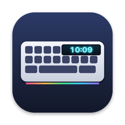

<p align="center">
  
</p>

<h1 align="center">YuhKeyScreen — LANGTU LT104 software for macOS</h1>

<p align="center">
  <b>English</b> · <a href="README.vi.md">Tiếng Việt</a> · <a href="README.zh-CN.md">简体中文</a>
</p>

<p align="center">
  Sync the clock and upload custom GIFs / images to the LCD screen of the
  <b>LANGTU LT104 (狼途 LT-104)</b> mechanical keyboard — natively on <b>macOS</b>.<br>
  The official LANGTU driver only runs on Windows. This is a free, open-source Mac alternative.
</p>

<p align="center">
  <a href="https://github.com/huypvnurani/langtu-lt104-macos/releases/latest"><b>⬇ Download for Mac</b></a>
  · macOS 14+ · Apple Silicon & Intel (Universal)
</p>

---

## Features

- **Clock sync** — sets the keyboard's on-screen clock (date and 24-hour time) to your Mac's time.
  Syncs automatically when you plug the keyboard in, when the Mac wakes from sleep, and every hour
  (the keyboard's clock drifts on its own).
- **Custom screen animation** — drag & drop an animated GIF, APNG, WebP, PNG, JPEG or HEIC.
  Preview it at the real 160×80 resolution and frame timing, choose *Fill* or *Fit*, then upload.
  The animation is stored on the keyboard and keeps playing even when unplugged.
- **Menu bar app** — lives in the menu bar, no Dock icon. Optional *Launch at login*.
- **No driver, no kernel extension, no admin password.** Talks to the keyboard over USB
  with Apple's IOKit / IOUSBHost APIs.
- **English, Tiếng Việt, 简体中文** interface, picked from your macOS language.
- Command line mode for scripting.

## Supported keyboard

| | |
|---|---|
| Model | LANGTU LT104 / LT-104 (狼途 LT-104) with 1.14" 160×80 TFT screen |
| USB ID | `0c45:8009` (SONiX SN32F240B) |
| Connection | **USB cable required.** Bluetooth and 2.4G modes can type but can't control the screen. |

Other LANGTU models with a screen (LT75, LT84…) may use a similar protocol but are not tested.

## Install

1. Download `YuhKeyScreen-x.y.z.zip` from [Releases](https://github.com/huypvnurani/langtu-lt104-macos/releases/latest)
   and unzip it.
2. Move **YuhKeyScreen.app** to **Applications**.
3. The app is not notarized by Apple, so the first launch is blocked. Either:
   - open it once, then go to **System Settings → Privacy & Security** and click **Open Anyway**, or
   - run in Terminal:
     ```bash
     xattr -dr com.apple.quarantine /Applications/YuhKeyScreen.app
     ```
4. Plug the keyboard in with the USB cable and click the ⌨️ icon in the menu bar.

## Usage

- **Sync now** sets the time immediately. Leave *Auto-sync* on and you never have to think about it.
- **Choose image/GIF…** (or drop a file on the preview), then **Upload to keyboard**.
  An 18-frame GIF takes about 17 seconds. While uploading, the keyboard backlight turns off
  for a moment — the official Windows software does the same, it's a limit of the keyboard's chip.
- Uploading replaces the animation currently on the keyboard. To go back to the stock look,
  upload [`samples/factory.gif`](samples/factory.gif).
- If the new animation doesn't show, switch the keyboard's screen mode to the custom animation
  with the knob.

### Command line

```bash
/Applications/YuhKeyScreen.app/Contents/MacOS/YuhKeyScreen --sync
/Applications/YuhKeyScreen.app/Contents/MacOS/YuhKeyScreen --upload my.gif [--fit]
/Applications/YuhKeyScreen.app/Contents/MacOS/YuhKeyScreen --launch-at-login on|off
```

## Build from source

Requires Xcode 15+ (or the Command Line Tools with Swift 5.10+).

```bash
git clone https://github.com/huypvnurani/langtu-lt104-macos.git
cd langtu-lt104-macos
./build.sh            # → dist/YuhKeyScreen.app and dist/YuhKeyScreen-x.y.z.zip
./build.sh --install  # also copies to /Applications and launches it
```

## Protocol

Protocol details come from
[iiaiiappa/lt104-keyboard-linux](https://github.com/iiaiiappa/lt104-keyboard-linux), which reverse-engineered
the official Windows `DeviceDriver.exe`. This app is an independent Swift implementation for macOS.

- **Interface 3** — 64-byte commands via HID `SET_REPORT` / `GET_REPORT` (feature). macOS attaches no
  driver to this interface, so the app sends control transfers directly through `IOUSBHostDevice`.
  - Clock: `04 18` → `04 28` (byte 8 = `01`) → `00 01 5A yy MM dd hh mm ss … 55 AA` → `04 02`.
- **Interface 2** (usage page `0xFF68`) — screen data as 4096-byte output reports; the keyboard
  acknowledges each chunk with a 64-byte input report.
  - Upload: `04 18` → `04 72 slot … chunks_lo chunks_hi` → 4096-byte chunks → `04 02`.
  - Payload: 256-byte header `[frame count, per-frame delay in 10 ms…, FF…]`, then 160×80 RGB565
    little-endian frames back to back, padded with `FF` to a multiple of 4096.

## FAQ

**Is there an official LANGTU LT104 driver for Mac?**
No. LANGTU only ships Windows software. YuhKeyScreen covers the clock and screen animation on macOS.

**Does it change RGB lighting or key mapping?**
Not yet. The lighting protocol is known, so it may come in a later version.

**Does it work over Bluetooth or the 2.4G dongle?**
No, the keyboard only accepts screen and clock commands over the USB cable.

## License

[GPL-3.0](LICENSE). Not affiliated with LANGTU.

<sub>Keywords: LANGTU LT104 Mac, LT-104 keyboard macOS software, 狼途 LT104 Mac 驱动, LANGTU keyboard
screen GIF Mac, LANGTU driver macOS, keyboard LCD clock sync Mac, 0c45:8009.</sub>
