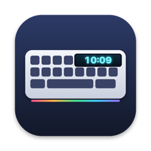

<p align="center">
  
</p>

<h1 align="center">YuhKeyScreen — Phần mềm bàn phím LANGTU LT104 cho macOS</h1>

<p align="center">
  <a href="README.md">English</a> · <b>Tiếng Việt</b> · <a href="README.zh-CN.md">简体中文</a>
</p>

<p align="center">
  Đồng bộ giờ và nạp ảnh / GIF lên màn hình của bàn phím cơ
  <b>LANGTU LT104 (狼途 LT-104)</b> ngay trên <b>Mac</b>.<br>
  Phần mềm chính hãng của LANGTU chỉ chạy trên Windows. Đây là bản thay thế miễn phí, mã nguồn mở cho macOS.
</p>

<p align="center">
  <a href="https://github.com/huypvnurani/probable-giggle/releases/latest"><b>⬇ Tải về cho Mac</b></a>
  · macOS 14 trở lên · Apple Silicon và Intel (Universal)
</p>

---

## Tính năng

- **Đồng bộ giờ**: chỉnh đồng hồ trên màn hình bàn phím (ngày và giờ 24h) theo giờ của Mac.
  Tự đồng bộ khi cắm bàn phím, khi Mac thức dậy sau sleep và mỗi giờ một lần, vì đồng hồ của bàn phím
  tự chạy lệch dần.
- **Ảnh động trên màn hình**: kéo thả GIF, APNG, WebP, PNG, JPEG hoặc HEIC. Xem trước đúng khổ
  160×80 và đúng tốc độ, chọn *Lấp đầy* hoặc *Vừa khung*, rồi nạp. Ảnh được lưu trong bàn phím,
  rút cáp ra vẫn chạy.
- **App menu bar**: nằm trên thanh menu, không chiếm Dock. Có tùy chọn *Mở cùng macOS*.
- **Không cần driver, không cần kernel extension, không cần mật khẩu admin.** App nói chuyện
  với bàn phím qua USB bằng IOKit / IOUSBHost của Apple.
- Giao diện **English, Tiếng Việt, 简体中文**, tự chọn theo ngôn ngữ của macOS.
- Có chế độ dòng lệnh để viết script.

## Bàn phím hỗ trợ

| | |
|---|---|
| Model | LANGTU LT104 / LT-104 (狼途 LT-104) có màn hình TFT 1.14" 160×80 |
| USB ID | `0c45:8009` (chip SONiX SN32F240B) |
| Kết nối | **Phải cắm dây USB.** Bluetooth và 2.4G chỉ gõ phím được, không chỉnh được màn hình. |

Các model LANGTU khác có màn hình (LT75, LT84…) có thể dùng giao thức tương tự nhưng chưa được thử.

## Cài đặt

1. Tải file `YuhKeyScreen-x.y.z.zip` ở mục [Releases](https://github.com/huypvnurani/probable-giggle/releases/latest)
   và giải nén.
2. Kéo **YuhKeyScreen.app** vào **Applications**.
3. App chưa được Apple notarize nên lần đầu mở sẽ bị chặn. Làm một trong hai cách:
   - mở app một lần, vào **System Settings → Privacy & Security** rồi bấm **Open Anyway**, hoặc
   - chạy lệnh trong Terminal:
     ```bash
     xattr -dr com.apple.quarantine /Applications/YuhKeyScreen.app
     ```
4. Cắm bàn phím bằng dây USB rồi bấm biểu tượng ⌨️ trên menu bar.

## Cách dùng

- Bấm **Đồng bộ giờ ngay** để chỉnh giờ liền. Để bật *Tự đồng bộ* thì không cần lo nữa.
- Bấm **Chọn ảnh/GIF…** (hoặc kéo file thả vào khung xem trước), rồi bấm **Nạp vào bàn phím**.
  GIF 18 khung mất khoảng 17 giây. Lúc nạp, đèn bàn phím sẽ tắt tạm. Phần mềm Windows chính hãng
  cũng vậy, đây là giới hạn của chip trong bàn phím.
- Nạp ảnh mới sẽ ghi đè ảnh đang có trên bàn phím. Muốn quay về hình gốc thì nạp file
  [`samples/factory.gif`](samples/factory.gif).
- Nếu không thấy ảnh mới, xoay núm để chuyển màn hình sang chế độ ảnh tùy chỉnh.

### Dòng lệnh

```bash
/Applications/YuhKeyScreen.app/Contents/MacOS/YuhKeyScreen --sync
/Applications/YuhKeyScreen.app/Contents/MacOS/YuhKeyScreen --upload anh.gif [--fit]
/Applications/YuhKeyScreen.app/Contents/MacOS/YuhKeyScreen --launch-at-login on|off
```

## Build từ mã nguồn

Cần Xcode 15 trở lên (hoặc Command Line Tools có Swift 5.10 trở lên).

```bash
git clone https://github.com/huypvnurani/probable-giggle.git
cd probable-giggle
./build.sh            # → dist/YuhKeyScreen.app và dist/YuhKeyScreen-x.y.z.zip
./build.sh --install  # copy luôn vào /Applications và mở app
```

## Giao thức

Giao thức lấy từ [iiaiiappa/lt104-keyboard-linux](https://github.com/iiaiiappa/lt104-keyboard-linux),
dự án đã giải mã phần mềm Windows `DeviceDriver.exe` chính hãng. App này được viết lại độc lập
bằng Swift cho macOS. Chi tiết kỹ thuật xem ở [README tiếng Anh](README.md#protocol).

## Câu hỏi thường gặp

**LANGTU có driver LT104 chính hãng cho Mac không?**
Không. LANGTU chỉ có phần mềm cho Windows. YuhKeyScreen lo phần đồng hồ và ảnh màn hình trên macOS.

**App có chỉnh đèn RGB hay đổi phím không?**
Chưa có. Giao thức chỉnh đèn đã biết nên có thể sẽ có ở bản sau.

**Dùng qua Bluetooth hay đầu thu 2.4G được không?**
Không, bàn phím chỉ nhận lệnh màn hình và đồng hồ qua dây USB.

## Giấy phép

[GPL-3.0](LICENSE). Không liên kết với LANGTU.

<sub>Từ khóa: phần mềm bàn phím LANGTU LT104 cho Mac, driver LANGTU macOS, đồng bộ giờ bàn phím LANGTU,
đổi GIF màn hình bàn phím LT104, bàn phím cơ có màn hình Mac, 狼途 LT104 Mac.</sub>
