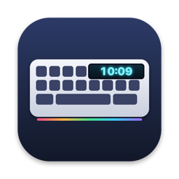

<p align="center">
  
</p>

<h1 align="center">YuhKeyScreen — 狼途 LANGTU LT104 键盘 macOS 驱动软件</h1>

<p align="center">
  <a href="README.md">English</a> · <a href="README.vi.md">Tiếng Việt</a> · <b>简体中文</b>
</p>

<p align="center">
  在 <b>Mac</b> 上为 <b>狼途 LANGTU LT104（LT-104）</b>机械键盘同步时钟、上传自定义 GIF / 图片到键盘屏幕。<br>
  狼途官方驱动只支持 Windows，本项目是免费、开源的 macOS 替代方案。
</p>

<p align="center">
  <a href="https://github.com/huypvnurani/probable-giggle/releases/latest"><b>⬇ 下载 Mac 版</b></a>
  · macOS 14 及以上 · 支持 Apple 芯片与 Intel（通用版）
</p>

---

## 功能

- **时钟同步**：将键盘屏幕上的时钟（日期和 24 小时制时间）设为 Mac 的时间。
  插入键盘、Mac 从睡眠唤醒以及每小时都会自动同步（键盘自带时钟会逐渐走偏）。
- **自定义屏幕动画**：拖入 GIF、APNG、WebP、PNG、JPEG 或 HEIC，按真实的 160×80 分辨率和帧速预览，
  选择「填充」或「适应」后上传。动画保存在键盘里，拔掉数据线后依然循环播放。
- **菜单栏应用**：常驻菜单栏，不占用程序坞，可选「登录时启动」。
- **无需驱动、无需内核扩展、无需管理员密码**，通过 Apple 的 IOKit / IOUSBHost 直接与键盘 USB 通信。
- 界面支持 **English、Tiếng Việt、简体中文**，自动跟随 macOS 系统语言。
- 支持命令行，便于脚本调用。

## 支持的键盘

| | |
|---|---|
| 型号 | 狼途 LANGTU LT104 / LT-104，带 1.14 英寸 160×80 TFT 屏幕 |
| USB ID | `0c45:8009`（SONiX SN32F240B） |
| 连接方式 | **必须使用 USB 有线连接。** 蓝牙和 2.4G 模式可以打字，但无法控制屏幕。 |

其他带屏幕的狼途型号（LT75、LT84 等）可能使用类似协议，但尚未测试。

## 安装

1. 在 [Releases](https://github.com/huypvnurani/probable-giggle/releases/latest) 下载 `YuhKeyScreen-x.y.z.zip` 并解压。
2. 将 **YuhKeyScreen.app** 拖到「应用程序」文件夹。
3. 本应用未经 Apple 公证，首次打开会被拦截，可任选一种方式：
   - 先打开一次，然后进入 **系统设置 → 隐私与安全性**，点击 **仍要打开**；或
   - 在终端运行：
     ```bash
     xattr -dr com.apple.quarantine /Applications/YuhKeyScreen.app
     ```
4. 用 USB 数据线连接键盘，点击菜单栏中的 ⌨️ 图标。

## 使用

- 点击 **立即同步** 马上校准时间；开启「自动同步」后无需再操作。
- 点击 **选择图片/GIF…**（或把文件拖到预览框），然后点击 **上传到键盘**。
  18 帧的 GIF 约需 17 秒。上传期间键盘背光会暂时熄灭，官方 Windows 软件也是如此，这是键盘芯片的限制。
- 上传会覆盖键盘上现有的动画。如需恢复出厂画面，上传 [`samples/factory.gif`](samples/factory.gif)。
- 如果看不到新动画，请用旋钮把屏幕切换到自定义动画模式。

### 命令行

```bash
/Applications/YuhKeyScreen.app/Contents/MacOS/YuhKeyScreen --sync
/Applications/YuhKeyScreen.app/Contents/MacOS/YuhKeyScreen --upload my.gif [--fit]
/Applications/YuhKeyScreen.app/Contents/MacOS/YuhKeyScreen --launch-at-login on|off
```

## 从源码构建

需要 Xcode 15 及以上（或带 Swift 5.10 以上的 Command Line Tools）。

```bash
git clone https://github.com/huypvnurani/probable-giggle.git
cd probable-giggle
./build.sh            # → dist/YuhKeyScreen.app 和 dist/YuhKeyScreen-x.y.z.zip
./build.sh --install  # 同时复制到 /Applications 并启动
```

## 协议

协议信息来自 [iiaiiappa/lt104-keyboard-linux](https://github.com/iiaiiappa/lt104-keyboard-linux)，该项目逆向了狼途官方
Windows 程序 `DeviceDriver.exe`。本应用是独立的 Swift macOS 实现。技术细节见[英文 README](README.md#protocol)。

## 常见问题

**狼途 LT104 有官方 Mac 驱动吗？**
没有，狼途只提供 Windows 软件。YuhKeyScreen 在 macOS 上实现了时钟和屏幕动画功能。

**能调 RGB 灯效或改键吗？**
暂不支持。灯效协议已知，后续版本可能加入。

**蓝牙或 2.4G 接收器能用吗？**
不能，键盘只通过 USB 数据线接收屏幕和时钟指令。

## 许可证

[GPL-3.0](LICENSE)。本项目与狼途 LANGTU 官方无关。

<sub>关键词：狼途 LT104 Mac 驱动，狼途键盘 macOS 软件，LT-104 屏幕 GIF 上传 Mac，狼途键盘时间同步 Mac，
带屏幕机械键盘 Mac，LANGTU LT104 macOS。</sub>
